# 🧭 Budget Master — Master Feature Registry & Dependency Architecture (`[FEAT-01]` to `[FEAT-62]`)

> **Document Version**: `2.1.0`  
> **Last Updated**: `October 2026`  
> **Status**: Official Codebase Architecture Reference  
> **Scope**: Complete catalog of all 62 modular features with tier classification, component mappings, and dependency graphs.

---

## 📌 Architectural Philosophy: Zero Regression & Strict Dependency Isolation

Budget Master is engineered as a **resilient, modular, offline-first personal finance platform**. Every capability is tagged with an immutable identifier (`[FEAT-XX]`) to ensure:
1. **Traceability**: Every UI button, modal, style block, and data pipeline maps to a specific feature ID.
2. **Clean Rollbacks & Safeties**: If any capability is ever rolled back or refactored, developers and agents can inspect its exact prerequisite chain and impacted components.
3. **Freemium Integrity**: Core personal budgeting is 100% free forever (`free`), automation and time-saving tools are unlocked in `pro`, while multi-entity books, cloud governance, and strategic wealth intelligence are reserved for `executive`.

---

## 🗺️ High-Level Feature Dependency Map

```mermaid
flowchart TD
    %% Core Infrastructure
    F13["[FEAT-13] LocalStorage Persistence"] --> F01["[FEAT-01] Monthly Budget Cycle & KPIs"]
    F01 --> F02["[FEAT-02] Bi-Monthly Income Planning"]
    F01 --> F03["[FEAT-03] Custom Categories"]
    F03 --> F04["[FEAT-04] Category Editing & Deletion"]
    F01 --> F05["[FEAT-05] Daily Expense Logging"]
    F05 --> F06["[FEAT-06] Budget vs Actual Variance"]
    F05 --> F07["[FEAT-07] Dashboard & Charts"]

    %% Cloud, AI & Governance
    F18["[FEAT-18] Firebase Cloud Auth"] --> F20["[FEAT-20] Cloud Firestore Sync"]
    F18 --> F43["[FEAT-43] Cloud Role Sync"]
    F20 --> F54["[FEAT-54] Admin Command Center & Directory"]
    F54 --> F55["[FEAT-55] Admin User Removal & CSV Export"]
    F19["[FEAT-19] App Guide & FAQ Modal"] --> F61["[FEAT-61] AI FAQ Copilot (BYOK Gemini)"]
    F61 --> F62["[FEAT-62] AI Feature Recommendation & Admin Wishlist Hub"]
    F54 --> F62

    %% Workspaces & Layouts
    F13 --> F27["[FEAT-27 v2] Multi-Workspaces Engine"]
    F27 --> F40["[FEAT-40] Smart Filter Popover"]
    F27 --> F52["[FEAT-52] Custom UI Layout Studio"]
    F27 --> F53["[FEAT-53] System & Data Tools Drawer"]
    F36["[FEAT-36] Multi-Layout Selector"] --> F58["[FEAT-58] Zen Minimalist Floating Popover"]
    F40 --> F58

    %% Category Management & Bulk Imports
    F03 --> F21["[FEAT-21] Category Multi-Select & Bulk Copy"]
    F04 --> F28["[FEAT-28] Month-Scoped Category Exclusion"]
    F03 --> F59["[FEAT-59] Bulk Category CSV Importer"]
    F59 --> F60["[FEAT-60] Category CSV Target Scope Engine"]
    F28 --> F60

    %% Bills & Automation
    F05 --> F32["[FEAT-32] Recurring Bills & Calendar"]
    F32 --> F34["[FEAT-34] Auto-Post Bills to Ledger"]
    F32 --> F37["[FEAT-37] Bills Sorting & Status Filter"]
    F05 --> F41["[FEAT-41] Bank Statement CSV Importer"]
    F05 --> F46["[FEAT-46] Expense Batch Multi-Select"]
    F05 --> F47["[FEAT-47] Merchant Memory & Quick-Fill"]

    %% Wealth & Sweepers
    F02 --> F38["[FEAT-38] Savings Analyst Waterfall"]
    F38 --> F39["[FEAT-39] 50/30/20 Wealth Diagnostic"]
    F39 --> F42["[FEAT-42] Needs vs Wants Category Tabs"]
    F42 --> F45["[FEAT-45] Zero-Based Auto-Optimizer"]
    F45 --> F49["[FEAT-49] 1-Click Month-End Surplus Sweeper"]
    F49 --> F51["[FEAT-51] Sinking Funds & Goals Hub"]

    %% Ergonomics & Stacking
    F11["[FEAT-11] Themes System"] --> F56["[FEAT-56] Tri-Tier Ambient Aura & Accents"]
    F57["[FEAT-57] High-Z Modal Stacking Architecture"] --> F55
    F57 --> F62
    F31["[FEAT-31] Single-Key Fast Nav"] --> F35["[FEAT-35] Shortcuts HUD"]
    F35 --> F48["[FEAT-48] Universal Command Palette"]
```

---

## 📑 Master Feature Audit & Specification Table (`[FEAT-01]` to `[FEAT-62]`)

| Feature Tag | Feature Name | Tier | Category | Component Dependencies | Core Architectural Purpose |
| :--- | :--- | :---: | :---: | :--- | :--- |
| **`[FEAT-01]`** | Monthly Budget Cycle Navigation | **Free Core** | Core Budget | Foundation (`appState.activeMonth`) | Month picker, previous/next month navigation, and base financial period state. |
| **`[FEAT-02]`** | Semi-Monthly Income Planning | **Free Core** | Cashflow | `[FEAT-01]` | 15th and 30th paycheck income modeling + side income and true savings calculation. |
| **`[FEAT-03]`** | Custom Category Creation | **Free Core** | Categories | `[FEAT-01]` | Create custom budget envelopes with name, keyword emoji detection, and color pickers. |
| **`[FEAT-04]`** | Category Editing & Deletion | **Free Core** | Categories | `[FEAT-03]` | Rename envelopes, adjust default targets, and delete with transaction safeguard. |
| **`[FEAT-05]`** | Daily Expense Logging & Ledger | **Free Core** | Transactions | `[FEAT-03]` | Core transaction entry with Date, Amount, Description, Category, and Payment Method. |
| **`[FEAT-06]`** | Budget vs. Actual Variance | **Free Core** | Analytics | `[FEAT-03]`, `[FEAT-05]` | Real-time dollar surplus/deficit calculation and envelope utilization metrics. |
| **`[FEAT-07]`** | Financial Health Dashboard & Charts | **Free Core** | Dashboard | `[FEAT-01]`, `[FEAT-05]` | KPI metric cards (Total Budget, Expenses, Remaining, Gauge) and Chart.js visuals. |
| **`[FEAT-08]`** | Multi-Currency Selector | **Free Core** | International | Standalone | Global currency formatting for PHP (`₱`), USD (`$`), EUR (`€`), GBP (`£`), etc. |
| **`[FEAT-09]`** | Sample Demo Dataset Loader | **Free Core** | Onboarding | `[FEAT-02]`, `[FEAT-03]`, `[FEAT-05]` | Populates realistic sample incomes, budgets, and transactions with Yes/No dialog. |
| **`[FEAT-10]`** | Full CSV & JSON Data Export | **Pro** | Portability | `[FEAT-05]`, `[FEAT-06]` | Downloadable Excel CSV variance report and complete JSON system backup. |
| **`[FEAT-11]`** | Dark & Light Themes System | **Free Core** | UI/Theme | CSS Variables | 5 visual themes (Dark Slate, Clean Light, Midnight OLED, Emerald, Cyber Neon). |
| **`[FEAT-12]`** | Multi-Month & YTD Range Analysis | **Executive** | Analytics | `[FEAT-01]`, `[FEAT-05]` | Aggregates income, budget, and expenses across quarters, YTD, or custom date spans. |
| **`[FEAT-13]`** | LocalStorage Persistence Engine | **Free Core** | Storage | Standalone | Offline-first, 100% private in-browser persistent key-value store. |
| **`[FEAT-14]`** | Clear Month Expenses Utility | **Free Core** | Maintenance | `[FEAT-05]` | One-click purge of all logged transactions strictly within the active month. |
| **`[FEAT-15]`** | Inline Category Card Budget Editing | **Free Core** | Ergonomics | `[FEAT-03]` | Direct in-grid budget allocation typing without opening modals. |
| **`[FEAT-16]`** | Reset All Amounts to Zero | **Free Core** | Maintenance | `[FEAT-02]`, `[FEAT-03]`, `[FEAT-05]` | Resets all numbers to 0 while keeping category structure; asks Yes/No confirmation. |
| **`[FEAT-17]`** | Responsive Adaptive Layout | **Free Core** | Ergonomics | CSS Media Queries | Flexible multi-breakpoint desktop, tablet, and mobile interface. |
| **`[FEAT-18]`** | Firebase Cloud Authentication | **Executive** | Security/Auth | Google Identity Platform | Google Sign-In and Email/Password multi-user sessions and persistent state. |
| **`[FEAT-19]`** | Built-in App Guide & FAQ Modal | **Free Core** | Help | Standalone | Searchable in-app knowledge base with 25 topics and category chips. |
| **`[FEAT-20]`** | Cloud Firestore Database Backend | **Executive** | Cloud Sync | `[FEAT-18]` | True multi-device NoSQL cloud database under isolated `/users/{uid}` paths. |
| **`[FEAT-21]`** | Category Multi-Select & Bulk Month Copy | **Pro** | Productivity | `[FEAT-03]`, `[FEAT-04]` | Multi-checkbox selection bar for mass category deletion and multi-month copying. |
| **`[FEAT-22]`** | Standard Payment Method Tags | **Free Core** | Transactions | `[FEAT-05]` | Classification tags for Cash, Credit Card, Debit Card, and Bank Transfer. |
| **`[FEAT-23]`** | Click-to-Edit Budget Target Pills | **Free Core** | Ergonomics | `[FEAT-03]`, `[FEAT-15]` | Clickable `Target: ₱...` badge on budget cards to adjust baseline allocation. |
| **`[FEAT-24]`** | Digital E-Wallets (GCash, Maya, PayPal) | **Free Core** | Transactions | `[FEAT-05]` | Dedicated transaction channels and registry filter chips for popular e-wallets. |
| **`[FEAT-25]`** | Variance Scorecard Column Sorting | **Pro** | Analytics | `[FEAT-06]` | Interactive multi-column table sorting with visual `▲`/`▼` indicators. |
| **`[FEAT-26]`** | Top Spending Categories Widget | **Free Core** | Dashboard | `[FEAT-05]`, `[FEAT-07]` | Auto-sorts by spending precedence, falling back to budgeted amounts if zero spend. |
| **`[FEAT-27 v2]`** | Isolated Multi-Workspaces Engine | **Executive** | Architecture | `[FEAT-13]`, `[FEAT-20]` | Partitioned financial books (Personal, Business, LLC) with 100% zero data bleed. |
| **`[FEAT-28]`** | Month-Scoped Category Exclusion | **Pro** | Core Budget | `[FEAT-04]`, `[FEAT-21]` | Remove categories strictly from current month with 1-click restore capability. |
| **`[FEAT-29]`** | Category Drilldown Accordions | **Pro** | Analytics | `[FEAT-06]`, `[FEAT-25]` | Interactive itemized sub-table inside variance rows to audit individual transactions. |
| **`[FEAT-30]`** | Safe-to-Spend Daily Allowance | **Pro** | Discipline | `[FEAT-01]`, `[FEAT-06]` | Real-time dynamic daily spending cap ($$\text{Remaining Budget} \div \text{Days Left}$$). |
| **`[FEAT-31]`** | Single-Key Fast Navigation | **Free Core** | Ergonomics | Standalone | Hotkeys (`N`, `D`, `B`, `E`, `A`, `Esc`) for lightning-fast power use. |
| **`[FEAT-32]`** | Recurring Bills & Subscriptions Calendar | **Pro** | Liabilities | `[FEAT-05]`, `[FEAT-27 v2]` | Recurring expense calendar with due date calculation and status badges. |
| **`[FEAT-33]`** | Proactive Bill Due & Overspend Alerts | **Pro** | Discipline | `[FEAT-06]`, `[FEAT-32]` | Pre-transaction 80% threshold warnings and due-date notifications. |
| **`[FEAT-34]`** | Auto-Post Recurring Bills to Ledger | **Pro** | Automation | `[FEAT-05]`, `[FEAT-32]` | Automatically converts due bills into expense transactions at month-start. |
| **`[FEAT-35]`** | Collapsible Keyboard Shortcuts HUD | **Pro** | Ergonomics | `[FEAT-31]` | Sleek dockable visual hotkey cheatsheet with animated keypress feedback. |
| **`[FEAT-36]`** | Multi-Layout UI Selector | **Pro** | UI/Theme | `[FEAT-11]` | Switch between Full Executive, Minimalist Zen, and Mobile Pocket interfaces. |
| **`[FEAT-37]`** | Bills Interactive Column Sorting | **Pro** | Liabilities | `[FEAT-32]` | Multi-status filtering, live search, and column sorting for recurring bills. |
| **`[FEAT-38]`** | Savings Analyst 7-Metric Cashflow Waterfall | **Executive** | Wealth | `[FEAT-02]`, `[FEAT-05]` | Panoramic cashflow intelligence from Gross Income to True Retained Wealth. |
| **`[FEAT-39]`** | 50/30/20 Wealth Diagnostic Benchmark | **Executive** | Wealth | `[FEAT-38]` | Real-time evaluation against standard 50% Needs, 30% Wants, 20% Savings rules. |
| **`[FEAT-40]`** | Smart Unified Filter Popover | **Pro** | Ergonomics | `[FEAT-01]`, `[FEAT-27 v2]` | Compact floating popover (`📁 Workspace • Month ▾`) with period selector. |
| **`[FEAT-41]`** | CSV Bank Statement Importer | **Pro** | Automation | `[FEAT-05]` | Batch transaction importer parsing bank exports into ledger records. |
| **`[FEAT-42]`** | Needs vs. Wants Budget Filter Tabs | **Executive** | Wealth | `[FEAT-03]`, `[FEAT-39]` | Interactive classification badges (`🛡️ Needs` / `✨ Wants`) on budget cards. |
| **`[FEAT-43]`** | Emergency Runway & FIRE Simulator | **Executive** | Wealth | `[FEAT-38]` | Calculates runway survival months and 10-year compound interest wealth projection. |
| **`[FEAT-44]`** | Executive Privacy Stealth Mode | **Executive** | Privacy | `[FEAT-31]` | One-click blur of all financial balances (`H` key) with peek-on-hover for public spaces. |
| **`[FEAT-45]`** | Zero-Based Budget Auto-Optimizer | **Executive** | Optimization | `[FEAT-02]`, `[FEAT-42]` | Algorithmic "every dollar has a job" rebalancer with proportional distribution. |
| **`[FEAT-46]`** | Expense Batch Multi-Select & Actions | **Pro** | Productivity | `[FEAT-05]`, `[FEAT-41]` | Mass category reassignment, payment tagging, and batch deletion with undo. |
| **`[FEAT-47]`** | Merchant Memory & Quick-Fill Engine | **Pro** | Automation | `[FEAT-05]` | Autocomplete datalist learning vendor names, amounts, and category history. |
| **`[FEAT-48]`** | Universal Command Palette (`Ctrl+K`) | **Pro** | Productivity | `[FEAT-31]`, `[FEAT-35]` | Raycast-style keyboard action launcher and omnibox navigation. |
| **`[FEAT-49]`** | 1-Click Month-End Surplus Sweeper | **Executive** | Wealth | `[FEAT-06]`, `[FEAT-38]` | Sweeps unspent envelope surpluses into permanent savings reserves with undo. |
| **`[FEAT-50]`** | Category Pacing & Burn-Rate Badges | **Pro / Exec** | Discipline/Wealth | `[FEAT-06]`, `[FEAT-49]` | Visual run-rate badges (Fast Burn, Frugal) + Unswept Surplus Timeline Prompt. |
| **`[FEAT-51]`** | Sinking Funds & Savings Goals Hub | **Executive** | Wealth | `[FEAT-49]` | Milestone savings pots, deposit/withdraw slips, and goal progress meters. |
| **`[FEAT-52]`** | Workspace Custom UI Layout Studio | **Executive** | Customization | `[FEAT-27 v2]` | Drag/toggle widget visibility and ordering across all 6 main application tabs. |
| **`[FEAT-53]`** | Slide-Over System & Data Tools Drawer | **Free Core** | System/Tools | `[FEAT-27 v2]`, `[FEAT-10]` | Non-intrusive slide-out drawer housing backup, reset, and workspace management tools. |
| **`[FEAT-54]`** | Admin Command Center & Customer Directory | **Executive** | Governance | `[FEAT-18]`, `[FEAT-20]`, `[FEAT-43]` | Real-time directory of registered users with auth provider, creation date, and last login. |
| **`[FEAT-55]`** | Administrative User Removal & Directory CSV Export | **Executive** | Governance | `[FEAT-54]`, `[FEAT-20]`, `[FEAT-57]` | Safe Firestore user document/subcollection deletion + 1-click customer roster CSV export. |
| **`[FEAT-56]`** | Tri-Tier Ambient Aura & Dynamic Modal Accents | **Free Core** | UI/Theme | `[FEAT-11]` | Glowing ambient status aura, dynamic modal accents, SVG tier badges, and clean Light mode. |
| **`[FEAT-57]`** | Layering & High-Z Modal Stacking Architecture | **Free Core** | Infrastructure | Core Modals | Stacking hierarchy (`z-index: 20000`) ensuring confirmation prompts render above overlays. |
| **`[FEAT-58]`** | Zen Minimalist Sidebar Floating Filter Popover | **Pro** | UI/Theme | `[FEAT-36]`, `[FEAT-40]` | Absolute floating popover anchored outside the 76px minimalist slim-rail dock. |
| **`[FEAT-59]`** | Bulk Category CSV Importer & Template Engine | **Free Core** | Core Budget | `[FEAT-03]`, `[FEAT-41]` | Bulk CSV parser for Category & Amount with smart emoji auto-assignment and template download. |
| **`[FEAT-60]`** | Category CSV Target Scope Engine (Month vs. Global) | **Free Core** | Core Budget | `[FEAT-59]`, `[FEAT-28]` | Live preview table and scope selector defaulting to isolated Current Month or Global. |
| **`[FEAT-61]`** | AI-Powered FAQ Copilot (BYOK Google Gemini Engine) | **Free Core** | Help & AI | `[FEAT-19]`, `[FEAT-13]` | Zero-developer-cost AI assistant inside the FAQ modal using the user's personal Google AI Studio Gemini key (`gemini-2.0-flash` / `2.5-flash` / `1.5-pro`) plus offline local knowledge base fallback. |
| **`[FEAT-62]`** | AI Feature Recommendation Collector & Admin Wishlist Hub | **Free / Exec** | Product & Governance | `[FEAT-61]`, `[FEAT-54]`, `[FEAT-20]`, `[FEAT-57]` | Automatically detects unbuilt features during AI FAQ chats, renders a 1-click "Send to Admin Wishlist" card, and equips the Admin Command Center with a Ranked Wishlist Hub (`Rank #1`–`#5`, Status workflow, Upvotes, CSV export). |

---

## 🔍 Detailed Feature Specifications (`[FEAT-53]` to `[FEAT-62]`)

### [FEAT-53] Slide-Over System & Data Tools Drawer
* **Entitled Tier**: `Free Core`
* **Affected Files**: `index.html` (`#systemToolsDrawerModal`), `app.js` (`openSystemToolsDrawer()`, `closeSystemToolsDrawer()`), `styles.css` (`.system-tools-drawer`)
* **Dependencies**: `[FEAT-27 v2]` (Drawer UX pattern), `[FEAT-10]` (Data export tools), `[FEAT-16]` (Zero-reset tools)
* **Description**:
  Provides a slide-out drawer accessible from the topbar or sidebar tools button. Consolidates system utilities (JSON database backup export, JSON restore, sample demo loader, reset all amounts to zero, and workspace options) into a clean, unified drawer without cluttering the primary budgeting views.
* **Safety Mechanism**: Direct child of `<body>` with focus trap and backdrop overlay dismiss.

---

### [FEAT-54] Admin Command Center & Customer Directory
* **Entitled Tier**: `Executive` (Restricted to verified Admins via `isCurrentUserAdmin()`)
* **Affected Files**: `index.html` (`#adminHubModal`), `app.js` (`openAdminHubModal()`, `renderAdminHubUsers()`), `firebase-auth.js` (`getUserRole()`), `styles.css` (`.admin-hub-card`)
* **Dependencies**: `[FEAT-18]` (Firebase Cloud Auth), `[FEAT-20]` (Cloud Firestore Database), `[FEAT-43]` (Admin Cloud Role Sync)
* **Description**:
  An executive administration suite providing real-time visibility into all registered member profiles in the Firebase Cloud Firestore database. Displays:
  - Account Email & Display Name
  - Authentication Provider (`Google` vs `Email`)
  - Creation Date (`createdAt`)
  - Last Login Timestamp (`lastLoginAt` / `lastLogin`)
  - Active Plan & Role Badge (`Admin`, `Executive`, `Pro`, `Free`)
  - Search filter by email/name and filter tabs by Role/Tier
  - Plan simulator to test application behavior across all 3 tiers with 1 click.
* **Security Guardrail**: Blocked for non-admins with immediate toast notification: *"Access Denied: Admin privileges required"*.

---

### [FEAT-55] Administrative User Removal & Directory CSV Export
* **Entitled Tier**: `Executive` (Restricted to verified Admins)
* **Affected Files**: `app.js` (`removeUserFromDatabase()`, `exportAdminCustomersToCSV()`), `index.html` (`#btnExportAdminCustomersCsv`), `styles.css`
* **Dependencies**: `[FEAT-54]` (Admin Command Center), `[FEAT-20]` (Cloud Firestore), `[FEAT-57]` (High-Z Modal Stacking)
* **Description**:
  Enables administrative data governance:
  1. **User Removal**: Clicking the 🗑️ action on any customer row prompts a confirmation dialog. Upon confirmation, executes batched deletion of the user's workspace subcollections (`/users/{uid}/workspaces`) and purges their root document (`/users/{uid}`) from Cloud Firestore. Prevents deleting the currently authenticated admin session.
  2. **1-Click Directory CSV Export**: Generates and downloads an Excel-compatible CSV file containing all registered customer records, auth provider, creation date, last login timestamp, and status.
* **Safety Mechanism**: High-Z confirmation modal (`[FEAT-57]`) stacks above the admin modal, with automated loading indicators (`⏳`) during deletion.

---

### [FEAT-56] Tri-Tier Ambient Aura & Dynamic Modal Accents
* **Entitled Tier**: `Free Core` (Active across Free, Pro, and Executive tiers)
* **Affected Files**: `styles.css` (`.tier-ambient-aura`, dynamic modal accents, light mode overrides), `index.html`, `app.js` (`applyUserTier()`)
* **Dependencies**: `[FEAT-11]` (Themes System), `[FEAT-01]` (Core Navigation)
* **Description**:
  A visual distinction system that adapts subtle ambient lighting, modal borders, and icon badges according to the active tier:
  - **🟢 Free Core**: Crisp Emerald Green accent (`#10b981`), Seedling brand icon, clean minimal borders, and high-contrast light mode styling.
  - **🔵 Budget Pro**: Cyan & Electric Blue luminous gradient (`#06b6d4` / `#3b82f6`), dynamic pulsing aura line, and neon card hover borders.
  - **🟣 Executive Wealth**: Imperial Gold shimmer (`#fbbf24` / `#d97706`), Crown badge, rich metallic accents, and high-roller status pills.
  - **Clean Light Mode**: Guaranteed high-contrast slate typography (`#0f172a`), solid white card backgrounds, and visible borders without muddy dark-mode bleed.

---

### [FEAT-57] Layering & High-Z Modal Stacking Architecture
* **Entitled Tier**: `Free Core` (Core Infrastructure)
* **Affected Files**: `styles.css` (`#confirmModal`), `app.js` (`askYesNo()`)
* **Dependencies**: Core Modal Overlays
* **Description**:
  Resolves CSS z-index stacking context collisions by establishing an absolute layering hierarchy:
  - Standard Modals & Drawers: `z-index: 3000` to `9999`
  - Admin Command Center Overlay: `z-index: 10000`
  - High-Priority Confirmation Dialog (`#confirmModal`): `z-index: 20000` (`.modal-card` at `z-index: 20001`)
  - Ensures sub-dialogs, delete confirmations, and alert modals never render trapped behind parent modals or drawer backdrops.

---

### [FEAT-58] Zen Minimalist Sidebar Floating Filter Popover
* **Entitled Tier**: `Pro`
* **Affected Files**: `styles.css` (`body.ui-mode-minimal .sidebar-filter-popover`), `app.js` (`applyUIMode()`, `openSidebarFilterPopover()`)
* **Dependencies**: `[FEAT-36]` (Multi-Layout UI Selector), `[FEAT-40]` (Smart Filter Popover)
* **Description**:
  Fixes popover layout clipping in the 76px minimalist slim-rail dock:
  - Anchors the popover as an absolute floating card (`left: 64px; top: 0; width: 300px; z-index: 2000`) outside the dock.
  - Renders workspace selection, a balanced 3-column quick action grid (`+ New`, `Rename`, `Manage`), and an unclipped period selector.
  - Eliminates horizontal overflow and text squishing in Zen Minimalist mode.

---

### [FEAT-59] Bulk Category CSV Importer & Template Engine
* **Entitled Tier**: `Free Core`
* **Affected Files**: `index.html` (`#btnUploadCategoryCSV`, `#btnDownloadCategoryCSVTemplate`, `#categoryCSVFileInput`), `app.js` (`handleCategoryCSVUpload()`, `processCategoryCSVContent()`, `downloadCategoryCSVTemplate()`)
* **Dependencies**: `[FEAT-03]` (Custom Categories), `[FEAT-04]` (Category Editing), `[FEAT-41]` (CSV Parser Engine)
* **Description**:
  Allows users to mass-onboard budget envelopes via standard CSV files:
  - **Default Fields**: `Category` and `Amount` (case-insensitive with flexible header aliases).
  - **Auto Emoji Detection (`detectCategoryIcon`)**: Scans category titles for 120+ keywords (e.g. "Gas" ➔ ⛽, "Coffee" ➔ ☕, "Rent" ➔ 🏠, "Health" ➔ 🩺).
  - **Auto Color Assignment (`getRandomCategoryColor`)**: Distinct color selection from 18 curated theme colors.
  - **Currency Cleaning**: Cleans `$`, `₱`, `€`, commas, and whitespace into raw decimal values.
  - **Sample Template Download**: 1-click download of `Category_Budget_Template.csv`.

---

### [FEAT-60] Category CSV Target Scope Engine (Current Month vs. Global)
* **Entitled Tier**: `Free Core`
* **Affected Files**: `index.html` (`#categoryCSVImportModal`), `app.js` (`openCategoryCSVImportModal()`, `processCategoryCSVContent()`), `styles.css`
* **Dependencies**: `[FEAT-59]` (Bulk Category CSV Importer), `[FEAT-28]` (Month-Scoped Category Exclusion), `[FEAT-01]` (Monthly Budget Navigation)
* **Description**:
  Provides an interactive pre-import modal (`#categoryCSVImportModal`) displaying:
  - Live preview table with detected emoji, parsed category name, and formatted amount.
  - Target Scope Radio Selection:
    1. **Current Month Only (Default)**: Automatically isolates the imported categories to the currently active month, adding them to `excludedCategoriesByMonth` for non-target months so past and future budgets remain uncorrupted.
    2. **Global (All Months)**: Creates the categories permanently across all months in the active workspace.
  - Full synchronization with Firebase Cloud Firestore and offline LocalStorage.

---

### [FEAT-61] AI-Powered FAQ Copilot (BYOK Google Gemini Engine)
* **Entitled Tier**: `Free Core` (0% server/API cost to developer)
* **Affected Files**: `index.html` (`#faqModeSwitcher`, `#faqAiCopilotPanel`, `#faqAiApiKeyInput`, `#faqAiModelSelect`, `#faqAiChatStream`), `app.js` (`switchFAQMode()`, `handleFaqAiSend()`, `callGoogleGeminiCopilot()`, `generateSmartLocalFaqResponse()`, `buildFaqSystemKnowledgePrompt()`), `styles.css` (`.faq-mode-switcher`, `.faq-ai-copilot-panel`, `.faq-ai-setup-card`, `.faq-ai-chat-stream`)
* **Dependencies**: `[FEAT-19]` (App Guide & FAQ Modal), `[FEAT-13]` (LocalStorage Persistence)
* **Description**:
  Embeds an interactive **Ask AI Copilot** mode inside the User Guide & FAQ modal (`#faqModal`):
  - **100% Zero Cost to Developer (BYOK)**: Users can paste their free personal Google AI Studio Gemini API key (`https://aistudio.google.com/app/apikey`). The key is stored strictly in their browser's `localStorage` (`budget_master_gemini_api_key`) and calls `generativelanguage.googleapis.com` directly from the client.
  - **Automatic Model Cascade**: Supports `gemini-2.0-flash`, `gemini-2.5-flash`, `gemini-1.5-flash`, and `gemini-1.5-pro` with automatic fallback if a specific model quota or version is unavailable.
  - **Zero-Key Smart Local Fallback**: Even before a user connects a Google API key, the built-in local knowledge engine searches all 25 FAQ topics and 62 feature specs to answer questions immediately.
  - **Contextual Grounding**: Feeds the user's non-sensitive UI context (Active Month, Currency, Active Plan Tier, UI Layout Mode, Category count) and the complete 62-feature documentation into the system prompt.

---

### [FEAT-62] AI Feature Recommendation Collector & Admin Wishlist Ranking Hub
* **Entitled Tier**: `Free Core` (User Submission & Upvoting) / `Executive Admin` (Admin Ranking Hub)
* **Affected Files**: `index.html` (`#faqFeatureRequestPanel`, `#btnAdminTabWishlist`, `#adminTabWishlist`, `#adminWishlistTable`), `app.js` (`detectMissingFeatureFromQuery()`, `submitFeatureRecommendation()`, `loadFeatureWishlist()`, `renderAdminWishlist()`, `updateWishlistItemRank()`, `updateWishlistItemStatus()`, `upvoteWishlistItem()`, `deleteWishlistItem()`, `exportAdminWishlistToCSV()`), `firestore.rules` (`/feature_wishlist/{wishId}`), `styles.css` (`.faq-ai-rec-card`, `.admin-wishlist-kpi-card`, `.admin-rank-select`, `.admin-status-select`)
* **Dependencies**: `[FEAT-61]` (AI FAQ Copilot), `[FEAT-54]` (Admin Command Center), `[FEAT-20]` (Cloud Firestore), `[FEAT-57]` (High-Z Modal Stacking)
* **Description**:
  Closes the product feedback loop between users and administrators without touching financial collections:
  1. **Automatic Missing-Feature Extraction**: When a user asks the AI Copilot for a capability that does not exist yet (e.g., Camera Receipt OCR, Direct Bank Plaid Sync, Crypto/Stock Tickers, Shared Family Workspaces, Native Mobile App), the AI outputs a structured `<FEATURE_RECOMMENDATION>` block (or uses local detection) and renders an interactive **"🚀 1-Click Send to Admin Wishlist"** card inside the chat bubble.
  2. **Direct Feature Request Tab & Community Upvoting**: Users can also submit ideas directly in the `💡 Recommend a Feature` tab of the FAQ modal and upvote (`👍`) existing community requests.
  3. **Admin Wishlist & Ranking Hub (`#adminTabWishlist`)**: Verified Admins get a dedicated 4th tab (`💡 AI Feature Wishlist`) in the Admin Command Center featuring:
     - **4 Live KPI Tiles**: Total Requests, Rank #1 Critical Priority count, Planned/In-Progress count, and Shipped count.
     - **Interactive Priority Ranking (`Rank #1` to `Rank #5` + `Unranked`)**: Instant dropdown assignment (`🔥 Rank #1 Critical`, `⚡ Rank #2 High`, `📌 Rank #3 Medium`, `🧊 Rank #4 Low`, `💤 Rank #5 Backlog`) synced to Cloud Firestore.
     - **Roadmap Status Workflow**: Update status between `🔍 Under Review`, `🗓️ Planned`, `🚧 In Progress`, `✅ Shipped`, and `❌ Declined`.
     - **Multi-Filter & CSV Export**: Filter by keyword, priority rank, or status; sort by Highest Priority Rank, Most Upvotes, or Newest; and export the entire ranked wishlist to CSV with 1 click.
* **Isolation Guarantee**: Stored in a dedicated top-level `/feature_wishlist/{wishId}` Firestore collection (with schema validation in `firestore.rules`) and `budget_master_feature_wishlist` in `localStorage`. Zero overlap with `/users/{uid}` financial data.

---

### [FEAT-63] AI Multi-Item Natural Language Ledger Parser & Visual Card
* **Entitled Tier**: `Free Core`
* **Affected Files**: `app.js` (`handleFaqAiSend()`, batch parsing regex), `index.html` (FAQ Item 26)
* **Dependencies**: `[FEAT-61]` (AI FAQ Copilot), `[FEAT-03]` (Custom Categories), `[FEAT-05]` (Daily Expense Entry), `[FEAT-32]` (Recurring Bills)
* **Description**:
  Allows users to speak or paste multiple items in a single sentence to NirvTrack AI:
  - **Category Batching**: `"Add categories: Gym 2000, Internet 1500, Pet Care 800"`
  - **Expense Batching**: `"Log expenses: Starbucks 190, Shell Gas 1500, Groceries 3400"`
  - **Recurring Bill Batching**: `"Add recurring bills: Netflix 549 on 15th, Spotify 149 on 20th"`
  - **Visual Confirmation Card**: Renders parsed entries inside the chat with colored badges, tags, and a master **↩️ Undo All** rollback button.

---

### [FEAT-64] Gmail Transaction Scanner & Staging Vetting Inbox
* **Entitled Tier**: `Budget Pro`
* **Affected Files**: `index.html` (`#gmailTransactionInboxModal`), `app.js` (`openGmailTransactionInboxModal()`, `processGmailInboxStaging()`), `styles.css`
* **Dependencies**: `[FEAT-05]` (Expense Logging), `[FEAT-41]` (CSV Importer), `[FEAT-18]` (Cloud Auth)
* **Description**:
  Secure client-side e-wallet and bank alert parser:
  - Extracts transaction amounts, merchants, dates, and payment methods from forwarded bank/e-wallet emails.
  - Presents an interactive staging vetting table where users can check, uncheck, edit, and approve candidate entries before writing to the permanent ledger.
  - Zero server storage of sensitive emails; 100% in-browser vetting.

---

### [FEAT-65] Automated PayMongo Webhook & Instant Subscription Upgrade Engine
* **Entitled Tier**: `System / Infrastructure`
* **Affected Files**: `Pipedream Unified Workflow`, `app.js` (`NIRVTRACK_PAYMONGO_CONFIG`, `finalizePayMongoTierUpgrade()`, `verifyPayMongoPayment()`), `firestore.rules`
* **Dependencies**: `[FEAT-18]` (Firebase Cloud Auth), `[FEAT-20]` (Cloud Firestore Database)
* **Description**:
  Automated server-side subscription lifecycle upgrade pipeline:
  - Receives live PayMongo `payment.paid` and `checkout_session.payment.paid` webhooks via Pipedream.
  - Automatically identifies plan tier: Executive (`maxWorkspaces: 99999`) vs. Pro (`maxWorkspaces: 5`).
  - Matches user by customer email and updates Cloud Firestore document with `tierStatus: "active"`, `paymentProvider: "paymongo"`, and exact timestamps.

---

### [FEAT-66] Dynamic Tier-Matched Celebration Modal with Confetti & Harmonic Chime
* **Entitled Tier**: `Free Core` (User Experience Engine)
* **Affected Files**: `index.html` (`#tierCelebrationModal`), `app.js` (`showTierUpgradeSuccessModal()`, `launchCelebrationConfetti()`, `playCelebrationChime()`), `styles.css` (`.celebration-modal-card`)
* **Dependencies**: `[FEAT-65]` (Automated Subscriptions), `[FEAT-56]` (Tri-Tier Ambient Aura)
* **Description**:
  Congratulatory post-upgrade experience triggered upon payment verification or cloud tier change:
  - **Custom Tier Styling**: Champagne Gold / Emerald Obsidian for Executive; Electric Cyan / Azure for Pro.
  - **Micro-Particle Canvas Engine**: 60fps lightweight confetti burst matching tier colors.
  - **Synthesized Web Audio Chime**: Uplifting major chord harmonic arpeggio (C5 - E5 - G5 - C6) synthesized via client Web Audio API with zero external audio assets.
  - **Interactive Superpowers Grid**: Displays unlocked capabilities and live receipt strip with `Amount Paid`.

---

### [FEAT-67] Real-Time Centavo Dynamic Price Recording & Cloud Firestore Sync
* **Entitled Tier**: `System / Infrastructure`
* **Affected Files**: `Pipedream Unified Workflow`, `app.js`, `index.html` (`#celebrationAmountPaid`)
* **Dependencies**: `[FEAT-65]` (PayMongo Webhook Engine), `[FEAT-66]` (Celebration Modal)
* **Description**:
  Dynamically extracts the exact centavos charged by PayMongo storefronts and payment links:
  - Divides centavos by 100 to calculate actual currency value (e.g. 100 -> ₱1.00, 2000 -> ₱20.00, 75000 -> ₱750.00).
  - Records the actual transaction price in Firestore (`amountPaid`, `lastPaymentAmount`).
  - Reflects the exact storefront number on user confirmation receipts and admin reports, ensuring seamless pricing experiments and promotional discounts without code changes.

---

## 🛠️ Maintenance & Future Expansion Guidelines (`[FEAT-68+]`)

Whenever introducing new features:
1. Assign the next sequential ID (starting from `[FEAT-68]`).
2. Add its tag to `FEATURE_TIERS` in `app.js` under the appropriate tier (`free`, `pro`, or `executive`).
3. Annotate functions, listeners, HTML templates, and CSS blocks with `// [FEAT-XX]`.
4. Ensure **prerequisite integrity**: A gated feature in Pro or Executive must NEVER depend on a prerequisite feature in a higher tier.
5. Verify that core personal budgeting in `Free Core` operates 100% offline with zero regression.

