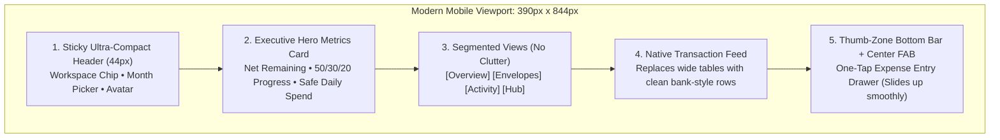

# NirvTrack Mobile: Enterprise-Grade Minimalist UI Architecture Proposal

## 🎯 Executive Summary
NirvTrack is packed with rich features (semi-monthly paycheck splits, 50/30/20 envelopes, multi-workspace switches, recurring bills, analytics, and admin command centers). On desktop, this information density is a strength. However, **on mobile screens (375px - 430px width), standard desktop layouts become noisy, overwhelming, and cramped with horizontal scroll fatigue.**

This proposal establishes an **enterprise-grade, thumb-optimized mobile architecture** that strips away visual noise while keeping 100% of NirvTrack’s power.

---

## 📱 The 5 Core Pillars of the Mobile Redesign

### 1. Sticky Ultra-Compact Topbar (44px height)
* **Problem on Mobile Currently**: Large headers with title, 8 icon buttons, month dropdown, currency, and theme take up over 35% of the initial mobile screen height.
* **The Enterprise Solution**:
  * Consolidate into a sleek **44px sticky bar**.
  * **Left**: App icon + Workspace chip dropdown (e.g. `Personal Budget ▾`).
  * **Right**: Clean month capsule (`📅 Oct 2026 ▾`) + Avatar.
  * Yields **90% of screen real estate** directly to user finances!

### 2. The Executive Hero Card (High-Glance Balance)
* Large, bold typography: **`₱42,500.00`** in JetBrains Mono.
* **Segmented Bar**: Visualizes Needs (cyan), Wants (purple), and Surplus Buffer (emerald) in one continuous 8px progress pill.
* **Two Micro-KPIs**:
  * **Safe Daily Spend**: `₱1,416.00 / day` (Instantly answers: *"How much can I spend today without breaking budget?"*).
  * **Payday Countdown**: `12 Days to 30th` (Syncs with NirvTrack's signature semi-monthly pay cycle).

### 3. Category Envelopes as Touch-Friendly Cards
* Replaces complex grid boxes with horizontal swipeable or vertical segmented cards:
  * Icon + Category Name + Needs/Wants tag.
  * Visual progress bar with spent vs budget.
  * Amount remaining clearly highlighted in emerald or amber.

### 4. Native Bank-App Transaction Feed (No Horizontal Tables)
* Wide 8-column HTML tables are unreadable on mobile phones without horizontal scrolling.
* Replaced with a **Date-Grouped Feed** (like Apple Pay, Revolut, or GCash):
  * Left: Category emoji circle + Title & Payment method.
  * Right: Amount in bold monospace (`-₱480.00` in red, `+₱55,000` in green) with timestamp.
  * Tapping any row opens an edit sheet with receipt notes and categorization.

### 5. Thumb-Zone Bottom Navigation & Center FAB
* Placed within natural thumb reach at the bottom of the screen:
  * 🏠 **Overview**: Net balance, top categories, monthly trajectory.
  * 📊 **Envelopes**: Needs vs Wants breakdown, 50/30/20 distribution.
  * 🧾 **Activity**: Searchable transaction history with filters.
  * 👑 **Hub**: Multi-workspaces, recurring bills, settings, Admin Hub.
* **Center Floating Action Button (FAB) `+`**:
  * Tapping opens a native **Bottom-Sheet Drawer** sliding up smoothly from the bottom.
  * Large keypad-friendly amount entry (`₱ 0.00`).
  * 4 quick category icons.
  * Single tap: **"Record Expense"** in under 3 seconds!

---

## 🛠️ Interactive Proof of Concept (PoC)

I have created a fully interactive, clickable Proof-of-Concept prototype directly in your workspace artifacts:

📱 **[Open Mobile UI Proof of Concept](file:///C:/Users/John%20Alvin%20Baylon/.gemini/antigravity/brain/d9d91b94-9527-4ad8-9dcb-3f5683c9e746/nirvtrack_mobile_poc.html)**

### Try these in the prototype:
1. Tap the bottom navigation tabs (**Overview**, **Envelopes**, **Activity**, **Hub**) to see each clean view.
2. Tap the glowing blue **`+` button** at the bottom to open the smooth one-tap expense logger drawer.
3. Review the **Executive Hero Card** with the semi-monthly payday indicator and safe daily spend limit.
