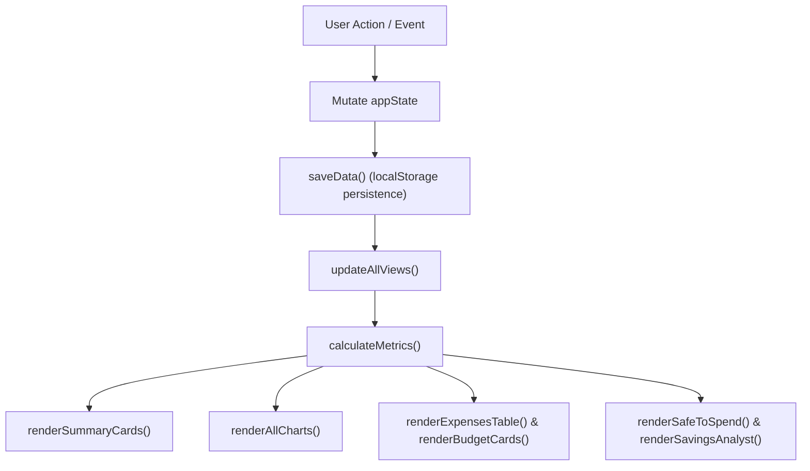

# NirvTrack Core Architect

A master-level engineering guide for designing, extending, and maintaining NirvTrack — an offline-first, zero-regression personal and enterprise financial platform built on vanilla JavaScript (ES6+), CSS custom properties, and semantic HTML5.

---

## 1. Architectural Philosophy & Foundations

NirvTrack is engineered with strict separation of concerns, high-density scannability, and deterministic state flows:
- **Offline-First & Local-First**: The browser (`localStorage`) is the primary and permanent source of truth for all data, settings, and workspace containers. The app operates with 100% functionality without internet access or remote servers.
- **Vanilla Performance**: Zero build step overhead. No heavy React/Vue/Angular runtimes. Direct DOM manipulation with optimized event delegation and micro-task batching.
- **Zero-Regression Guarantee**: Every feature is mapped to an immutable ID (`[FEAT-01]` through `[FEAT-68+]`). Any refactoring or extension must preserve existing feature compatibility.

---

## 2. Core State Anatomy (`appState`)

The central nervous system of NirvTrack is the global `appState` object located in [app.js](file:///c:/Users/John%20Alvin%20Baylon/OneDrive/AI%20Projects/NirvTrack%202.0/app.js).

### Key State Properties
```javascript
const appState = {
  activeMonth: 'YYYY-MM',          // Current active financial period
  activeMonths: [],                // Multi-month active range for Executive analytics [FEAT-12]
  currency: '₱',                   // Global active currency symbol ($, ₱, €, £, etc.)
  theme: 'aurora',                 // Active theme: 'aurora' | 'dark' | 'midnight' | 'emerald' | 'cyber'
  uiMode: 'default',               // 'default' (Executive) | 'minimalist' | 'mobile'
  categories: [],                  // Budget categories: [{ id, name, icon, color, defaultBudget, budgetType }]
  incomes: {},                     // Monthly income records: { 'YYYY-MM': { paycheck15: 0, paycheck30: 0, additional: 0 } }
  budgets: {},                     // Monthly envelope targets: { 'YYYY-MM': { [categoryId]: number } }
  expenses: [],                    // Actual expense transactions: [{ id, date, amount, description, categoryId, paymentMethod, notes, budgetType }]
  plannedExpenses: [],             // Future commitments: [{ id, date, amount, description, categoryId, paymentMethod, notes, budgetType }]
  recurringBills: [],              // Automated bills & subscriptions schedule [FEAT-32]
  savingsGoals: [],                // Sinking funds and financial goals [FEAT-51]
  surplusSweeps: {},               // Swept surplus wealth lock-ins: { 'YYYY-MM': number } [FEAT-49]
  wallets: [],                     // Liquid cash & e-wallet accounts [FEAT-WALLETS-ACCOUNTS]
  activeWorkspaceId: 'ws_default', // Currently active workspace ID [FEAT-27 v2]
  workspaces: [],                  // Workspace directory: [{ id, name, icon, color, createdAt }]
  workspaceContainers: {},         // Isolated dataset containers per workspace
  userSettings: {
    privacyMode: false,            // Obscure monetary figures with blur/dots [FEAT-44]
    visibleWidgets: {},            // Widget visibility toggles [FEAT-52]
    collapsedWidgets: {}           // Accordion collapse memory
  }
};
```

---

## 3. Data Flow & Rendering Lifecycles

Whenever data changes (add, edit, delete, or switch period), follow the canonical update pipeline:



### Critical Rules:
1. **Never bypass `saveData()`**: Persists state to `localStorage` immediately using namespaced storage keys (`getStorageKey()`).
2. **Always call `updateAllViews()`**: Triggers top-level metric re-computation and refreshes all active tabs, charts, variance tables, and status badges.
3. **Guard Event Bubbling (`e.stopPropagation()`)**: Any button, menu trigger, or inline action located inside an accordion header, table row, or draggable card MUST stop propagation to prevent unintentional expand/collapse triggers.

---

## 4. Multi-Workspace Isolated Container Engine (`[FEAT-27 v2]`)

NirvTrack supports multiple independent financial workspaces (e.g. Personal, Business, Freelance, Family):
- The active dataset is stored directly on `appState` for zero-overhead performance.
- When switching workspaces:
  1. The current active state is serialized into `appState.workspaceContainers[currentId]`.
  2. The target workspace container is deserialized into `appState`.
  3. `saveData()` and `updateAllViews()` are triggered immediately.
- Workspace containers maintain strict data isolation: transactions, budgets, income schedules, and recurring bills in one workspace never collide with another.

---

## 5. High-Z Modal Stacking Architecture (`[FEAT-57]`)

NirvTrack implements an advanced, collision-free modal management system:
- **Z-Index Layer Hierarchy**:
  * Canvas/Cards: `z-index: 1 - 10`
  * Sticky Headers / Topbar: `z-index: 100 - 200`
  * Floating Action Button (FAB) / Mobile Dock: `z-index: 500 - 800`
  * Standard Dialogs (Expense, Category, Budget): `z-index: 1000 - 1050`
  * Nested Confirmation / Warning Modals: `z-index: 1100 - 1150`
  * Spotlight Command Palette / AI Copilot: `z-index: 1200 - 1250`
  * Toast Notifications & Micro-Haptic Prompts: `z-index: 9999`
- **Graceful Motion (`closeModalGracefully()`)**:
  Modals use an accelerated 140ms ease-out CSS transition before removal to prevent visual stuttering.
- **ESC & Click-Outside Handling**: Always register cleanup listeners to close top-most active modals gracefully.

---

## 6. Implementation Checklist for New Features (`[FEAT-XX]`)

When introducing any new capability:
1. **Allocate sequential Feature Tag**: Determine the next ID (e.g. `[FEAT-69]`) and register in [FEATURES.md](file:///c:/Users/John%20Alvin%20Baylon/OneDrive/AI%20Projects/NirvTrack%202.0/FEATURES.md).
2. **Entitlement Gate**: Add to `FEATURE_TIERS` in [app.js](file:///c:/Users/John%20Alvin%20Baylon/OneDrive/AI%20Projects/NirvTrack%202.0/app.js) with `canAccessFeature('[FEAT-XX]')` guard.
3. **Data Isolation**: Ensure any new persistent keys are added to `appState` and sanitized in `loadData()` and `saveData()`.
4. **Theme & Privacy Compliance**:
   - Ensure all rendered currency numbers include `data-privacy-mask="true"`.
   - Use CSS custom tokens (`var(--bg-secondary)`, `var(--text-primary)`, `var(--border-subtle)`).
5. **Interactive Patch Notes Synchronization**: Add release entry to `APP_PATCH_NOTES` with executable `gui` preview descriptor.
