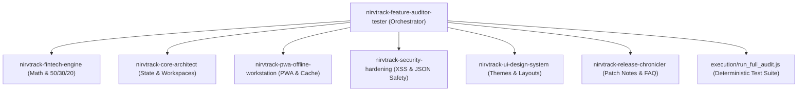

# NirvTrack Feature Auditor & Tester

A master testing and feature verification skill that orchestrates cross-domain quality audits across NirvTrack's frontend, calculations, PWA shell, security defenses, and design tokens.

---

## 1. Multi-Skill Collaboration Architecture

This skill operates as the central auditor, coordinating with specialized NirvTrack domain skills:



---

## 2. The Automated Test Suite (`execution/run_full_audit.js`)

NirvTrack includes a deterministic Node.js test runner covering 80+ verification points:

### 2.1 Running the Audit
Execute via the workspace terminal:
```bash
node execution/run_full_audit.js
```
Or using absolute paths if Node is not on PATH:
```powershell
& "C:\Program Files\nodejs\node.exe" "execution/run_full_audit.js"
```

### 2.2 Test Coverage Domains
1. **PWA & Offline Workstation Assets**:
   - Validates existence of all core files (`index.html`, `styles.css`, `app.js`, `patch-notes-data.js`, `ai-copilot-engine.js`, icons, manifest, service worker).
   - Validates that every asset listed in `sw.js`'s `PRECACHE_ASSETS` exists physically on disk.
   - Validates `manifest.json` standalone mode and PWA shortcuts.
2. **DOM Element Bindings & Layout Integrity**:
   - Confirms that critical containers exist in `index.html` (`#kpiTotalIncome`, `#budgetCategoryGrid`, `#expensesTableBody`, `#categoryModal`, `#sidebar`, etc.).
   - Confirms the initial auth overlay is inactive and hidden.
   - Confirms zero un-commented external database script tags.
3. **FinTech Arithmetic & 50/30/20 Invariants**:
   - Validates all 15 default categories have valid emojis and strict `needs`/`wants` classifications.
   - Verifies 50/30/20 budget envelope ratios ($\text{Needs} = 50\%$, $\text{Wants} = 30\%$, $\text{Savings} = 20\%$).
   - Verifies Month-End Surplus Sweeper cash lock-in identity.
   - Verifies Safe-to-Spend pacing calculations and floating-point centavo epsilon rounding.
4. **Security & Data Hardening**:
   - Tests `escapeHTML()` against `<script>`, `onerror`, and attribute escape vectors.
   - Verifies zero active executable `eval()` calls.
   - Tests JSON backup validator against corrupted and malformed payloads.
5. **UI Themes & Layout Modes**:
   - Validates all 5 themes (`aurora`, `dark`, `midnight`, `emerald`, `cyber`) are defined in `styles.css`.
   - Validates responsive mode styles (`.ui-mode-mobile`, `.ui-mode-minimalist`).
6. **Patch Notes & FAQ Synchronization**:
   - Validates `APP_PATCH_NOTES` versioning and interactive `gui` sandbox descriptors.

---

## 3. Local Web Server Smoke Testing

To test real browser rendering and service worker caching:
1. Launch the local PowerShell web server:
   ```powershell
   powershell -NoProfile -ExecutionPolicy Bypass -File "start-app.ps1"
   ```
2. Navigate to `http://localhost:7777/`.
3. Verify:
   - HTTP 200 OK.
   - Zero console errors in browser DevTools.
   - Instant local storage responsiveness on adding an expense or editing a budget.
