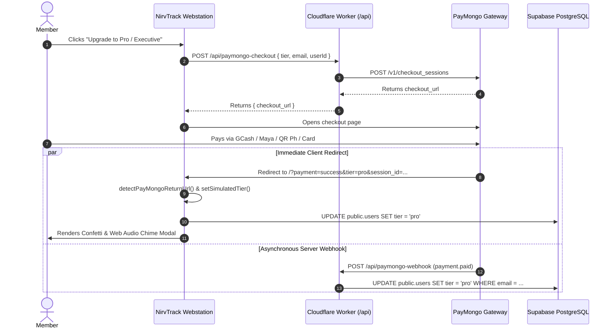

# NirvTrack PayMongo Subscription & Gateway Pipeline

A specialized engineering guide for managing payments, subscription lifecycle, and entitlements in NirvTrack 2.0 via PayMongo (QR Ph, GCash, Maya, Cards) and Supabase PostgreSQL.

---

## 1. Overview & Architecture

NirvTrack operates a **hybrid dual-pipeline** for subscription upgrades:
1. **Edge Checkout Generator (`/api/paymongo-checkout`)**: Generates pre-filled PayMongo checkout sessions with user email, metadata, and dynamic return URLs.
2. **Instant Client-Side Return URL Listener**: When PayMongo redirects back to NirvTrack with `?payment=success&tier=pro`, the frontend immediately unlocks the tier in `localStorage` and updates Supabase `public.users`.
3. **Serverless Edge Webhook (`/api/paymongo-webhook`)**: Receives real-time asynchronous `payment.paid` and `checkout_session.payment.paid` events from PayMongo, validates the signature, and updates `public.users` in Supabase PostgreSQL by customer email.
4. **1-Click Self-Service Verification**: Users who paid on another device (or via static storefront link) can click "Verify & Unlock" to trigger immediate tier verification.



---

## 2. Subscription Tiers & Pricing Specs

| Tier | Price (PHP) | Duration | PayMongo Centavos | Entitlements |
| :--- | :--- | :--- | :--- | :--- |
| **`free`** | ₱0.00 | Lifetime | 0 | 1 Workspace, Core Budgeting, Local Offline Storage |
| **`pro`** | ₱199.00 | 30 Days | 19900 | 5 Workspaces, AI Copilot, Cloud Sync, PDF/CSV Reports |
| **`executive`** | ₱599.00 | 30 Days | 59900 | Unlimited Workspaces, Advanced Wealth Analytics, VIP Support |

---

## 3. Database Schema Mapping (Supabase PostgreSQL)

Subscription entitlements are stored in `public.users`:

```sql
-- public.users columns for subscriptions:
-- id: VARCHAR(128) PRIMARY KEY (matches auth.users.id)
-- email: VARCHAR(255)
-- tier: VARCHAR(32) DEFAULT 'executive' CHECK (tier IN ('free', 'pro', 'executive'))
-- updated_at: TIMESTAMPTZ DEFAULT NOW()
```

### Updating User Tier in Supabase (Client SDK):
```javascript
await window.sbClient
  .from('users')
  .update({
    tier: targetTier,
    updated_at: new Date().toISOString()
  })
  .eq('id', activeUid);
```

### Updating User Tier in Supabase (Edge Worker REST):
```javascript
await fetch(`${SUPABASE_URL}/rest/v1/users?email=eq.${encodeURIComponent(email)}`, {
  method: 'PATCH',
  headers: {
    'apikey': SUPABASE_SERVICE_ROLE_KEY || SUPABASE_ANON_KEY,
    'Authorization': `Bearer ${SUPABASE_SERVICE_ROLE_KEY || SUPABASE_ANON_KEY}`,
    'Content-Type': 'application/json',
    'Prefer': 'return=minimal'
  },
  body: JSON.stringify({
    tier: targetTier,
    updated_at: new Date().toISOString()
  })
});
```

---

## 4. Key Functions Reference

- `detectPayMongoReturnUrl()`: Examines URL search parameters on boot. If `payment=success`, invokes `finalizePayMongoTierUpgrade()` and strips the query parameters via `window.history.replaceState`.
- `proceedToPayMongoCheckout()`: Gathers user email, calls `/api/paymongo-checkout`, and opens the checkout session in a new tab.
- `finalizePayMongoTierUpgrade(targetTier, paymentId, paymentMethod, customAmountPhp)`: Synchronizes `appState.userTier`, updates local storage, updates Supabase `public.users`, and triggers `showTierUpgradeSuccessModal()`.
- `verifyPayMongoPayment()`: Allows users to manually confirm and verify their completed PayMongo payment.
