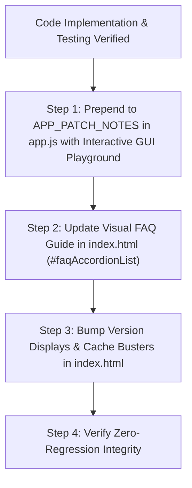

# NirvTrack Release Chronicler

An automated documentation, version control, and interactive GUI playground protocol for NirvTrack releases. Every code change, visual improvement, and security hardening update must be chronicled before concluding any task.

---

## 1. The 4-Step Mandatory Release Pipeline

Whenever ANY changes or fixes are implemented, execute this sequence:



---

## 2. Step 1: Prepend to `APP_PATCH_NOTES` in `app.js`

Add the new release object at index 0 of `APP_PATCH_NOTES`:

```javascript
{
  version: 'v1.20261022.98',      // Format: v1.YYYYMMDD.NN
  date: 'Oct 22, 2026',
  title: 'Executive Title Summarizing New Value',
  badge: 'Latest ✨',
  badgeType: 'latest',
  summary: 'Concise 1-2 sentence executive summary of the release.',
  features: [
    {
      type: 'feature',            // 'feature' | 'improvement' | 'fix' | 'security'
      tag: '[FEAT-XYZ]',
      title: 'Icon + Descriptive Title',
      desc: 'Detailed explanation of behavior, benefits, and user flow.',
      // MANDATORY Interactive GUI Preview & Live Test Sandbox
      gui: {
        type: 'button',           // 'button' | 'badge' | 'widget' | 'input'
        previewHtml: '<button class="btn btn-xs btn-outline-cyan">🚀 Test Action</button>',
        actionLabel: 'Try It Live 🚀',
        actionCode: 'openTargetModal();' // Executable JS expression or handler key
      }
    }
  ]
}
```

### Important:
Demote the previous top release:
- Change its `badge` from `'Latest ✨'` to `'Previous'`.
- Change its `badgeType` from `'latest'` to `'neutral'`.

---

## 3. Step 2: Synchronize Visual FAQ Guide in `index.html`

For every new workflow or modified capability, add or update a dedicated FAQ accordion item inside `#faqAccordionList` in [index.html](file:///c:/Users/John%20Alvin%20Baylon/OneDrive/AI%20Projects/Budget%20Expenses%20App/index.html):

```html
<div class="faq-accordion-item" data-category="budget" data-keywords="keyword1, keyword2, feature name">
  <button class="faq-accordion-header" type="button">
    <div class="faq-header-left">
      <span class="faq-category-badge category-budget">Budget</span>
      <span class="faq-question-text">How do I use [Feature Name]?</span>
    </div>
    <span class="faq-chevron">▾</span>
  </button>
  <div class="faq-accordion-content">
    <div class="faq-answer-inner">
      <p>Explanation of what the feature does and how to use it.</p>
      <div class="faq-steps-list">
        <div class="faq-step-row">
          <span class="faq-step-number">1</span>
          <div class="faq-step-text">Click on the relevant button or navigation tab.</div>
        </div>
      </div>
    </div>
  </div>
</div>
```

Valid `data-category` options: `start`, `workspaces`, `budget`, `expenses`, `bills`, `analytics`, `layouts`, `cloud`, `ai`.

---

## 4. Step 3: Synchronize Version Displays & Cache Busters

Ensure the new version string matches across all UI surfaces:

1. **Sidebar Brand Header**: `#brandPatchBadge`
2. **Sidebar Tools Footer**: `#sidebarVersionDisplay`
3. **Mobile Topbar Pill**: `#mobileBrandVersionBadge`
4. **Browser Tab Title**: `<title>` in `index.html` and `document.title` in `app.js`
5. **Cache Busters**: Bump query strings in `index.html`:
   ```html
   <link rel="stylesheet" href="styles.css?v=20261022.98">
   <script src="app.js?v=20261022.98"></script>
   ```

---

## 5. Step 4: Zero-Regression Certification

Verify:
- Financial math (50/30/20 envelopes, Net Worth balance sheet, remaining cashflow) remains 100% intact.
- Both Dark 🌙 and Light ☀️ themes render with high contrast and legible text.
- Desktop (Executive 🖥️), Zen (Minimalist ✨), and Mobile Pocket 📱 layouts render properly without broken flex wrapping.
- All live sandbox test buttons in the Patch Notes modal execute without throwing errors.
