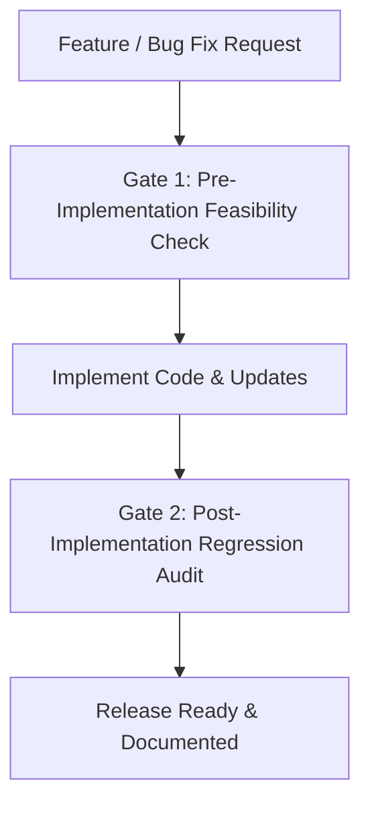

# NirvTrack Testing & QA Guardian

A quality assurance, zero-regression audit, and automated verification protocol for NirvTrack. This skill formalizes the mandatory **Two-Gate Safety Process** defined in [AGENTS.md](file:///c:/Users/John%20Alvin%20Baylon/OneDrive/AI%20Projects/NirvTrack%202.0/AGENTS.md).

---

## 1. The Mandatory Two-Gate Safety Process

Every feature request, refactor, or bug fix must pass both gates:



---

## 2. Gate 1: Pre-Implementation Feasibility Check

Before modifying code in [app.js](file:///c:/Users/John%20Alvin%20Baylon/OneDrive/AI%20Projects/NirvTrack%202.0/app.js) or [index.html](file:///c:/Users/John%20Alvin%20Baylon/OneDrive/AI%20Projects/NirvTrack%202.0/index.html), verify:
1. **Financial Math Collision**: Confirm the proposed change will not alter or corrupt:
   - 50/30/20 envelope calculations (`needs`, `wants`, `savings`).
   - Month-End Surplus Sweeper cash lock-ins.
   - Semi-monthly paycheck cashflow cushion calculations.
   - Multi-currency symbol formatting and decimal rounding.
2. **DOM Element Safety**: Verify target IDs and classes exist and do not collide with existing element bindings.
3. **Event Propagation Risk**: Identify whether clickable triggers sit inside accordions or table rows; ensure `e.stopPropagation()` is planned.
4. **Theme & Responsive Adaptability**: Confirm the proposed component will render cleanly across all 5 themes and in Executive, Minimalist, and Mobile Pocket modes.

---

## 3. Gate 2: Post-Implementation Verification & Regression Audit

After code changes are made, run this verification checklist:

### 3.1 Financial Arithmetic Verification
- **Income Identity**: $\text{Remaining} = \text{Total Income} - \text{Total Expenses}$.
- **Zero-State Integrity**: Verify that triggering `#btnResetAll` safely resets budgets and transactions to zero without deleting categories.
- **Centavo/Cent Precision**: Confirm all currency math rounds to 2 decimal places with zero floating point drift (e.g. `0.1 + 0.2 = 0.30000000000000004` prevented via `Math.round(val * 100) / 100`).

### 3.2 LocalStorage & Workspace State Verification
- Confirm mutations persist to `localStorage` immediately upon user action.
- Verify that switching workspaces (`ws_default` vs. custom workspace) preserves separate budgets and transaction ledgers with zero cross-contamination.

### 3.3 Local Server Smoke Test (`start-app.ps1`)
Test that the web server serves the application shell cleanly:
```powershell
powershell -NoProfile -ExecutionPolicy Bypass -File "start-app.ps1"
```
Verify:
- HTTP 200 OK for `http://localhost:7777/index.html`.
- Zero 404 network errors in the browser console for scripts or stylesheets.
- Service Worker registers cleanly without cache failures.

### 3.4 Release Synchronization Audit
Confirm compliance with the automatic documentation rule in `AGENTS.md`:
1. `APP_PATCH_NOTES` in `app.js` has the new release prepended with an interactive `gui` playground descriptor.
2. `#faqAccordionList` in `index.html` has a corresponding visual explanation.
3. Version displays (`#brandPatchBadge`, `#sidebarVersionDisplay`, `<title>`) are incremented.
4. Cache-buster query parameters (`?v=...`) on script tags in `index.html` are bumped.
